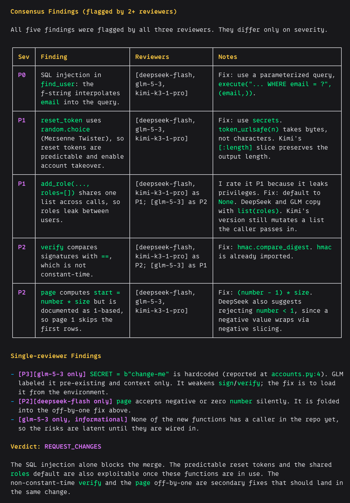
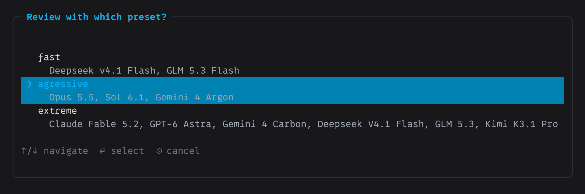
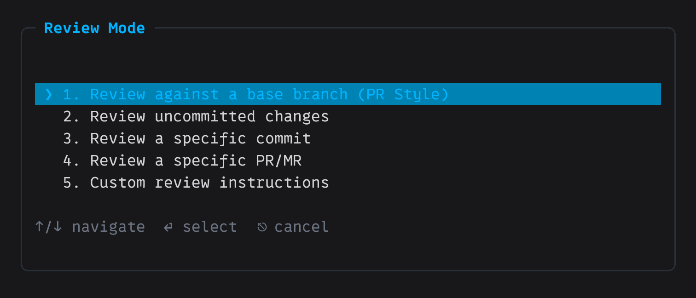
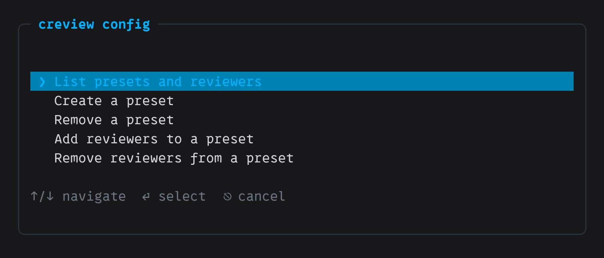
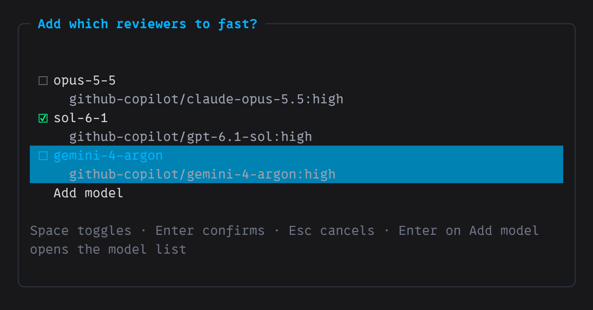
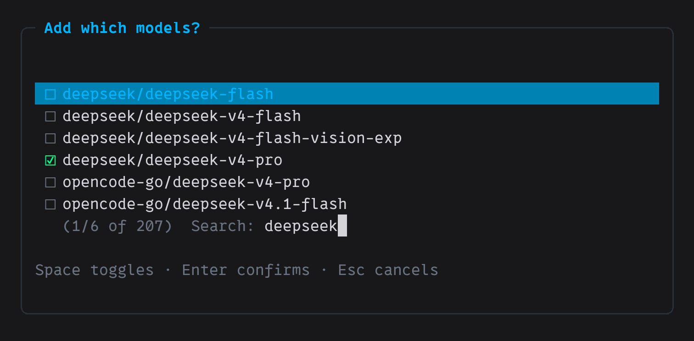

<p align="center"></p>

---

**creview** is an extension for [omp (oh-my-pi)](https://github.com/can1357/oh-my-pi) and [pi](https://github.com/earendil-works/pi), the coding agent harnesses. It runs several models as reviewers on the same diff in parallel, and the main agent merges their findings into one report with a verdict. Reviewers are grouped into **presets**, and you manage creview from menus, with no file editing.

## Why

Every model misses bugs that another one catches. creview runs your code past several models at once, so a bug one model misses is likely caught by another, and issues flagged by several models stand out as consensus.

<p align="center"></p>

## Install

Install Git and the harnesses you want to use (`pi`, `omp`, or both) first, and make sure their commands are on your `PATH`. These scripts install creview, not the harnesses.

### One-line install

**Windows (PowerShell):**

```powershell
powershell -NoProfile -Command "irm https://raw.githubusercontent.com/exphck1337/creview/main/install.ps1 | iex"
```

**macOS / Linux:**

```sh
curl -fsSL https://raw.githubusercontent.com/exphck1337/creview/main/install.sh | sh
```

In an interactive PowerShell console, use **Up/Down** to move, **Space** to toggle a checkbox, **Enter** to install for the checked hosts, or **Esc** to cancel. Check both **pi** and **omp** to install for both.

On macOS/Linux or in PowerShell without an interactive console, type **1** for **pi** or **2** for **omp**, then press Enter to toggle. Press Enter on an empty line to install for the checked hosts.

The installer uses one shared clone in `~/.creview` (`$HOME\.creview` on Windows). Run the same command again to update creview and register the selected hosts without uninstalling. The installer preserves `creview.json` and stops rather than overwriting local changes or unpublished commits. Restart the selected hosts after installing or updating.

## Use

First, create a preset: run `/creview-config`, choose **Create a preset**, name it, and add the models you want as reviewers.

```
/creview                                 pick a preset and what to review
/creview <preset> [scope, instructions]  review straight away, e.g. /creview all main..HEAD
/creview-config                          create or remove presets, add or remove reviewers
```

<p align="center"></p>

<p align="center"></p>

The report has consensus findings with the reviewers that agreed, every finding grouped P0 to P3 and tagged with its reviewers, and a verdict (`APPROVE`, `COMMENT` or `REQUEST_CHANGES`). For a single model, use omp's own `/review`.

Both hosts use [creview's reviewer prompt](templates/reviewer.md). It asks reviewers to trace changed behavior across code boundaries and report only actionable findings backed by the diff.

## Manage presets

<p align="center"></p>

Tick reviewers with Space, confirm with Enter. **Add model** opens the list of every model your harness can use.

Presets belong to the host where you create them: omp and pi have separate lists and can use the same preset name independently. Reviewers remain shared, so you can reuse them in either host when its models are available.

Both hosts use one `creview.json` in this folder: `reviewers` is global, and `presets` contains separate `omp` and `pi` maps (`"presets": { "omp": { "all": ["reviewer-name"] }, "pi": {} }`). Existing flat presets are read as omp presets; pi starts with none. The next successful write saves the new format and preserves both hosts' presets. After updating the extension, restart **both omp and pi** before managing presets so neither uses the old code.

<p align="center"></p>

<p align="center"></p>
